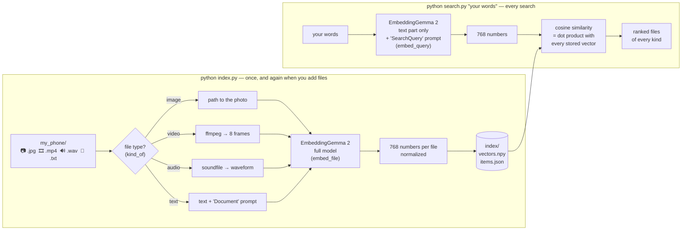

# One search box for photos, videos, sounds and chats

A minimal, readable example of **multimodal search** with Google's open
[EmbeddingGemma 2](https://huggingface.co/google/embeddinggemma-2). Three short Python files, no UI,
no database, no cloud API: everything runs on your own laptop.

Drop photos, videos, sounds, voice notes and chat messages into `my_phone/`, run `index.py` once,
then search them in plain words:

```
$ python search.py "my dog at the beach"

  0.715  💬 text   fri_chat_bruno_chasing_the_waves.txt
  0.715  📷 image  fri_photo_dog_running_on_a_beach.jpg
  0.636  🔊 audio  fri_sound_a_dog_barking.wav
  0.606  🎞 video  fri_video_waves_rolling_onto_the_beach.mp4
  0.601  💬 text   mon_chat_knee_deep_water_outside_the_station.txt
```

The chat never says "dog" (only "Bruno"), and the photo and the bark have no words at all.
They're found because EmbeddingGemma 2 puts **every kind of file into the same 768-number space**.

## How it works



| File | What it does |
|---|---|
| [`embed.py`](embed.py) | The only code that touches the model: `load_model()`, `embed_file()` (one file → 768 numbers) and `embed_query()` (your words → 768 numbers). Both scripts import it, so files and queries are guaranteed to land in the same space. |
| [`index.py`](index.py) | Scans `my_phone/`, embeds new or changed files with the full model, saves `index/vectors.npy` (one row per file) and `index/items.json` (which row is which file). |
| [`search.py`](search.py) | Embeds your query (text-only model, or the full model for `--file`), takes the dot product with every stored vector, prints the top results. |
| [`config.json`](config.json) | Model id, folders, prompts, video frame count, which extensions count as which kind. |

Three details that matter:

* **The model never sees file names.** Only pixels, waveforms and the text inside `.txt` files. (The sample names are descriptive just so the results are readable.)
* **Prompts:** stored text gets the `Document` prompt and queries get the `SearchQuery` prompt, as the model card recommends. Photos, video and audio take no prompt.
* **Same model, two sizes:** indexing needs the full model (text + vision + audio encoders, ~3.5 GB RAM on CPU). A text search only needs the text part (~1.7 GB). Same weights, so the vectors are identical.

## Run it

```bash
python -m venv .venv
```
```bash
source .venv/bin/activate        # Windows: .venv\Scripts\activate
```
```bash
pip install -r requirements.txt
```
```bash
python index.py                  # first run downloads the model (~1.5 GB), then embeds 28 files (~9 min on a laptop CPU)
```
```bash
python search.py "stuck in the rain on the way home"
```

Video needs the `ffmpeg` command line installed (`winget install ffmpeg`, `brew install ffmpeg`,
`sudo apt install ffmpeg`). Without it, remove the `.mp4` files and everything else still works.

More things to try:

```bash
python search.py "festival of lights" --only image video
```
```bash
python search.py --file my_phone/fri_sound_a_dog_barking.wav --only image
```
```bash
python search.py "fixing my cycle" --dim 256
```

* `--only` keeps certain kinds. Use it when searching **with** a file: a sound is closer to other
  sounds than to photos, and chats score a little higher than everything else (the "modality gap"),
  so ask for the kind you want back. The bark with `--only image` returns the beach dog first.
* `--dim 256` uses only the first 256 of the 768 numbers. EmbeddingGemma 2 is trained so that
  shortened vectors still work (Matryoshka), so you can store a third as much.

## Use your own files

Replace the contents of `my_phone/` with your own photos, videos, audio and `.txt` notes, then run
`python index.py` again. Only new or changed files are embedded, and your files never leave your machine.

## Sample data

A Mumbai monsoon week, 28 files across 7 days: a flooded commute, a flat tyre, evening chai, a cricket
night, Bruno at the beach, street-food Saturday and getting ready for Diwali. Photos, videos and sounds
come from Wikimedia Commons (see [my_phone/CREDITS.md](my_phone/CREDITS.md)). Voice notes are
text-to-speech and the chats were written for this demo.

## License

Code: MIT. Model: [google/embeddinggemma-2](https://huggingface.co/google/embeddinggemma-2) (Apache 2.0).
Sample media: see [my_phone/CREDITS.md](my_phone/CREDITS.md).
